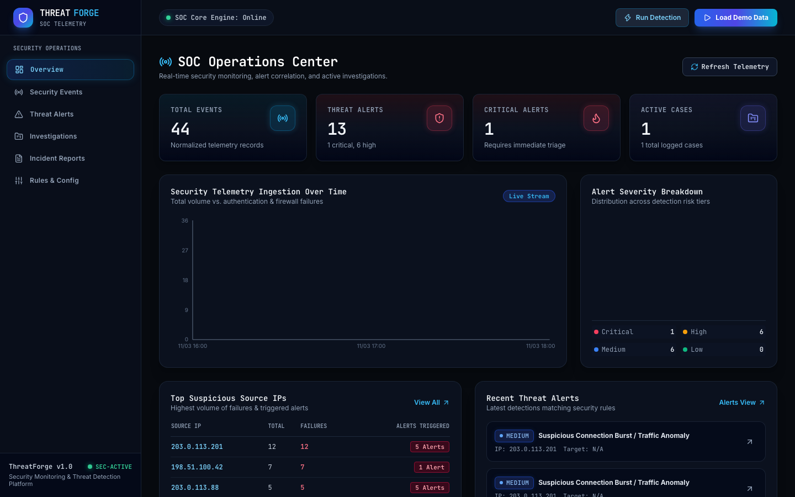
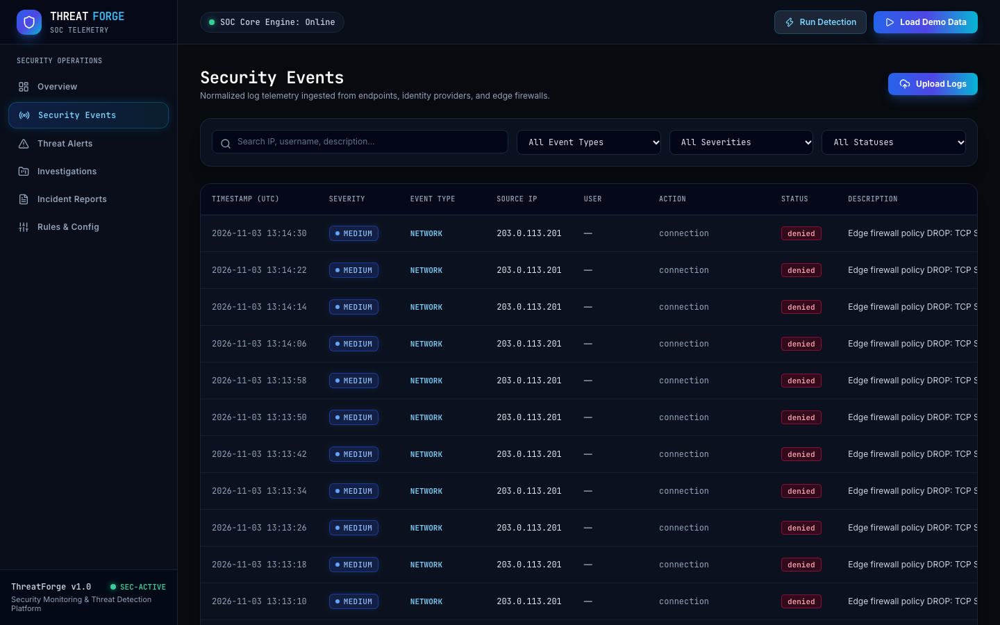
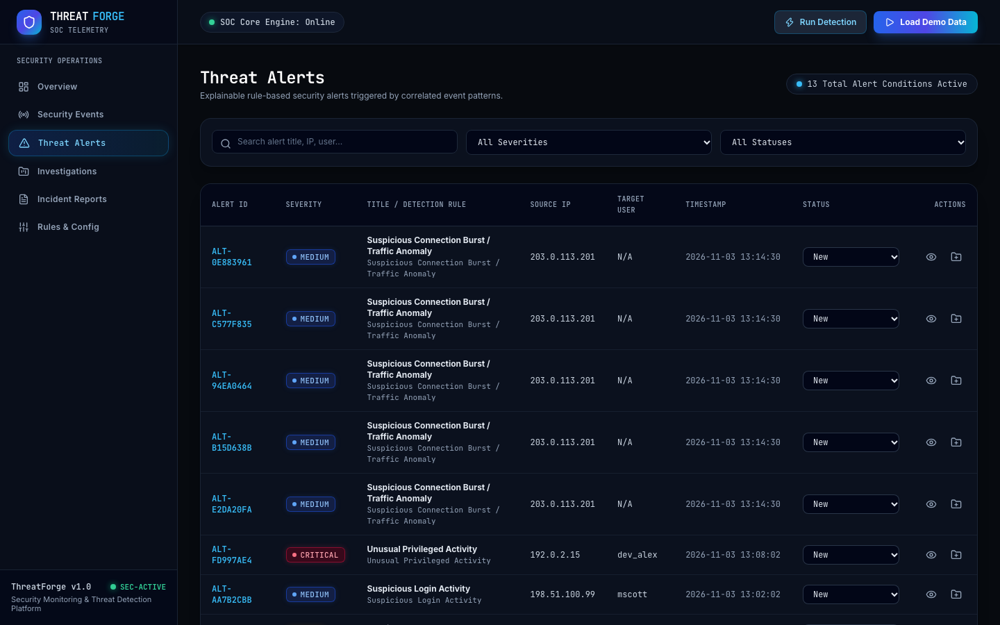
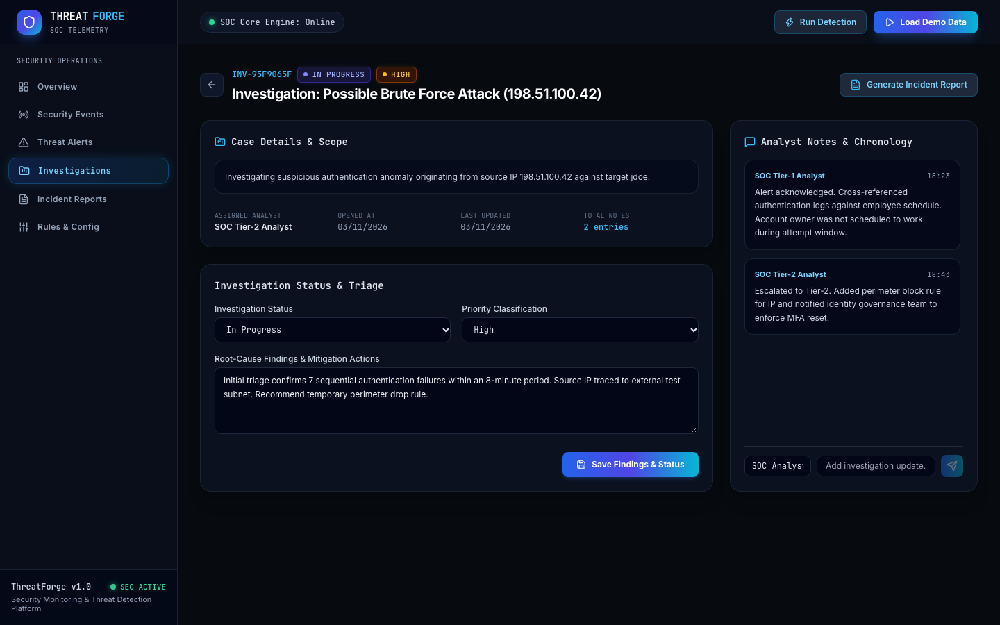
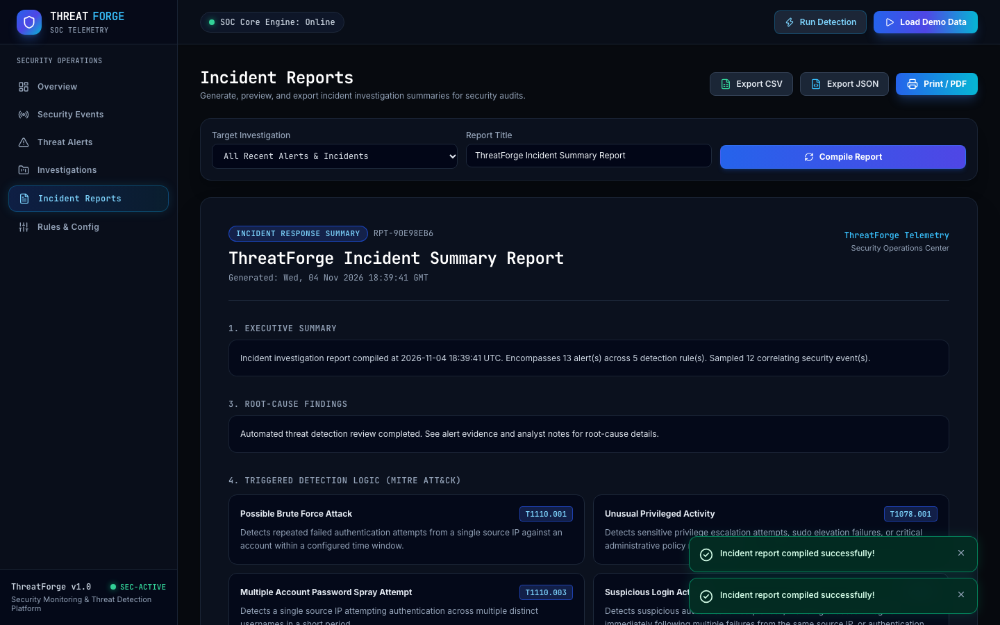
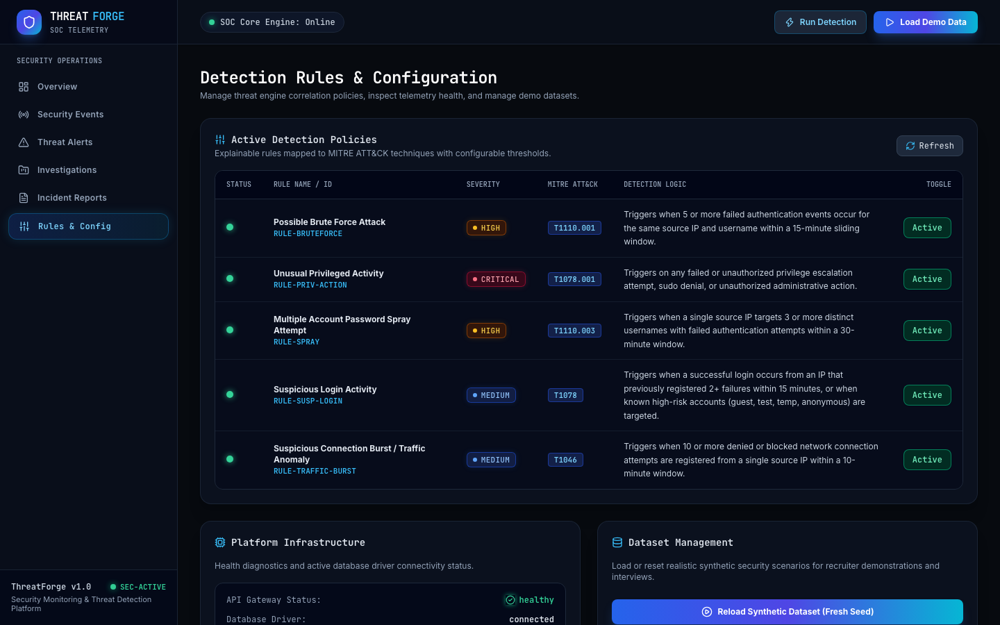

# ThreatForge — Security Monitoring & Threat Detection Platform

[](https://fastapi.tiangolo.com/)
[](https://react.dev/)
[](https://www.typescriptlang.org/)
[](https://www.python.org/)
[](https://tailwindcss.com/)
[](https://docs.pytest.org/)

**ThreatForge** is a full-stack cybersecurity monitoring, threat detection, and incident response platform designed for security operations center (SOC) analysts, security engineers, and cybersecurity learners. 

It ingests multi-source security telemetry, normalizes heterogeneous log structures into a standardized schema, executes explainable rule-based threat correlation mapped to the **MITRE ATT&CK® Framework**, coordinates forensic investigation workflows, and compiles audit-ready incident reports.

> **Portfolio & Educational Notice**: ThreatForge is designed to demonstrate realistic security monitoring workflows, detection engineering, and full-stack development. It uses synthetic telemetry and authorized log sets for demonstrations. It is not intended to replace multi-cluster, enterprise-scale SIEM solutions.

---

## 1. Problem Statement & Motivation

Modern security teams face immense telemetry volumes from cloud identity providers, endpoint detection agents, and network firewalls. Extracting actionable signal from raw noise requires:
1. **Schema Normalization**: Unifying diverse field naming schemes (`src_ip` vs `client_ip`, epoch vs ISO-8601 timestamps).
2. **Explainable Detection Logic**: Avoiding black-box alerts by tying detections directly to documented adversary behaviors (MITRE ATT&CK).
3. **Structured Investigation Lifecycles**: Escalating raw alerts into collaborative cases with timestamped forensic notes, root-cause findings, and status tracking.
4. **Audit Reporting**: Exporting clean, machine-readable summaries for compliance and post-incident review.

ThreatForge was engineered from the ground up to solve these core challenges in an accessible, fully interactive web application.

---

## 2. Core Features

### 🛡️ Real-Time SOC Operations Dashboard
- Dynamic, real-time KPI metrics (Total Ingested Events, Active Alerts, Critical/High Threats, Active Cases).
- Interactive event volume area chart comparing overall telemetry vs. authentication/network failures.
- Radial donut chart displaying alert severity distribution across detection tiers.
- Top suspicious source IP rankings summarizing attack frequencies and triggered alerts.
- One-click synthetic demo dataset generator with duplicate prevention.

### 📥 Resilient Log Ingestion & Normalizer
- Upload support for structured **JSON** and **CSV** security logs.
- Validation engine enforcing file size limits (up to 10MB default) and schema integrity.
- Tolerant field normalization mapping aliases (`ip`, `client_ip`, `user`, `login`, `result`, `outcome`) into standardized ThreatForge schemas.
- Rejection of malformed records with detailed error breakdowns without crashing running workloads.

### ⚡ Explainable Threat Detection Engine
Deterministic detection rules mapped to the MITRE ATT&CK framework:
1. **Possible Brute Force Attack (`RULE-BRUTEFORCE` / T1110.001)**: Detects $\ge 5$ sequential failed authentications within 15 minutes.
2. **Suspicious Login Activity (`RULE-SUSP-LOGIN` / T1078)**: Flags credential breakthroughs (success after repeated failures) and targeting of dormant guest/service accounts.
3. **Password Spray Attempt (`RULE-SPRAY` / T1110.003)**: Flags single source IPs probing $\ge 3$ distinct accounts with invalid credentials within 30 minutes.
4. **Unusual Privileged Activity (`RULE-PRIV-ACTION` / T1078.001)**: Catches unauthorized sudo invocations, root escalation failures, and critical policy changes.
5. **Traffic Anomaly / Connection Burst (`RULE-TRAFFIC-BURST` / T1046)**: Identifies $\ge 10$ firewall denials within 10 minutes indicative of port scanning.

### 🔎 Case Management & Investigation Workflow
- Single-click escalation from any threat alert directly into an Investigation Case.
- Multi-status lifecycle: `Open` $\to$ `In Progress` $\to$ `Closed`.
- Real-time forensic notes timeline with author attributions and timestamps.
- Findings editor to document indicators of compromise (IOCs) and containment actions.
- Automatic resolution of linked alerts upon closing an investigation.

### 📄 Comprehensive Incident Reporting
- Automatically compiles executive summaries, correlated alerts, event samples, MITRE technique tags, and analyst findings.
- One-click export to spreadsheet-ready **CSV** and machine-readable **JSON**.
- Styled browser print/PDF view for audit presentations.
- Standardized educational audit disclaimers.

---

## 3. Technology Stack

### Frontend
- **Framework**: React 18 with Vite
- **Language**: TypeScript 5.7
- **Styling**: Tailwind CSS (custom dark obsidian & cyan/emerald cybersecurity palette)
- **Data Visualization**: Recharts (Area charts, Pie/Donut charts)
- **Routing**: React Router v6
- **Icons**: Lucide React
- **Testing**: Vitest + React Testing Library + JSDOM

### Backend
- **Framework**: FastAPI (Python 3.12)
- **Data Validation & Settings**: Pydantic v2 + Pydantic-Settings
- **ORM & Database**: SQLAlchemy 2.0 (SQLite for local dev, PostgreSQL for production)
- **File Parsing**: Python standard `csv`, `json`, and `io` with streaming upload safeguards
- **Server**: Uvicorn ASGI Server
- **Testing**: Pytest + HTTPX + in-memory SQLite with StaticPool

---

## 4. Application Screenshots

### SOC Operations Center (Overview Dashboard)
> Real-time security telemetry, active threat alerts, Recharts event volume timeline, and top suspicious IP rankings.



---

### Security Events & Telemetry Ingestion
> Normalized log telemetry with full-text search, multi-factor filters (Severity, Event Type, Status), and CSV/JSON upload modal.



---

### Threat Alerts & Correlated Evidence
> MITRE ATT&CK correlated detections with sliding-window indicator details, status dropdowns, and case escalation.



---

### Incident Investigation Workspace
> Case details, status workflow, root-cause findings editor, and real-time analyst notes chronology.



---

### Incident Audit Report
> Executive summary, triggered detection rules, correlated alerts, forensic samples, and one-click JSON/CSV downloads.



---

### Detection Policies & Platform Diagnostics
> Policy management table with MITRE mapping, rule parameter adjustments, and platform health telemetry.



---

## 5. Architecture Overview

```
[ Raw Security Logs ] (JSON / CSV / Firewalls / EDR)
         │
         ▼
[ Log Normalizer & Validator ] ──> [ SQLite / PostgreSQL ]
         │                                    ▲
         ▼                                    │
[ Threat Detection Engine ] ──────────────────┤
 (MITRE ATT&CK Correlation)                   │
         │                                    │
         ▼                                    │
[ Threat Alerts ] ──> [ Investigation Cases ]─┘
         │
         ▼
[ Incident Report Generator ] ──> [ JSON / CSV / Printable PDF ]
```

Detailed technical architecture documentation is available in [docs/architecture.md](docs/architecture.md).

---

## 6. Installation & Local Development

### Prerequisites
- **Python**: Version 3.10+ (tested on Python 3.12.9)
- **Node.js**: Version 18+ (tested on Node v24.12.0 with npm 11.6.2)
- macOS, Linux, or Windows (WSL recommended)

### 1. Clone Repository & Setup Environment
```bash
git clone <your-repository-url>
cd ThreatForge

# Copy environment configuration
cp .env.example .env
```

### 2. Backend Setup
```bash
# Navigate to backend directory
cd backend

# Create and activate Python virtual environment
python3 -m venv .venv
source .venv/bin/activate

# Install dependencies
pip install -r requirements.txt

# Run backend development server
uvicorn app.main:app --reload --host 0.0.0.0 --port 8000
```
- Backend will start at: `http://localhost:8000`  
- Interactive Swagger API docs: `http://localhost:8000/docs`

### 3. Frontend Setup (New Terminal)
```bash
# Navigate to frontend directory
cd frontend

# Install Node dependencies
npm install

# Start Vite development server
npm run dev
```
- Frontend will be available at: `http://localhost:5173`

---

## 7. Running Tests

Testing is comprehensive across both backend and frontend layers:

### Run Backend Tests (Pytest)
```bash
cd backend
source .venv/bin/activate
pytest -v
```
*Coverage includes: Application startup, health check, event normalization, file validation & rejection, all 5 MITRE detection rules, alert lifecycle, case notes, report generation, and complete end-to-end integration workflow (15 tests).*

### Run Frontend Tests (Vitest)
```bash
cd frontend
npm test
```
*Coverage includes: UI components, status badges, StatCards, empty state handlers, responsive navigation sidebar, and mock API integration (6 tests).*

---

## 8. Sample Logs & Demonstration Telemetry

ThreatForge includes realistic, RFC-compliant synthetic log sets in `sample-logs/`:
- `sample-logs/authentication.json`: SSH brute force attempts and benign Okta SSO logins.
- `sample-logs/sample-security-events.json`: Unauthorized sudo escalation attempts and multi-account password spray events.
- `sample-logs/network-firewall.csv`: TCP SYN scan drops across firewall policies.

You can upload these files directly via the **Upload Logs** modal on the Security Events page, or simply click **Load Demo Data** in the top navigation bar to populate the platform instantly.

---

## 9. Production Deployment

- **Frontend**: Prepared for zero-config deployment on **Vercel** with SPA routing rewrites configured in `frontend/vercel.json`.
- **Backend**: Configured for **Render** (or Docker/Heroku) with production health check endpoints and PostgreSQL support.
- **Database**: Documented migration from local SQLite to managed PostgreSQL.

Step-by-step production setup instructions can be found in [docs/deployment.md](docs/deployment.md).

---

## 10. Security & Ethical Considerations

- **Authorization**: ThreatForge is designed strictly for authorized security monitoring and educational demonstration. It does not perform active network scanning or probe external networks.
- **Synthetic Data**: All bundled sample datasets use documentation-reserved IP addresses (RFC 5737: `198.51.100.0/24`, `203.0.113.0/24`, `192.0.2.0/24`) and fictional identifiers.
- **Secure Code**: All database queries are strictly parameterized through SQLAlchemy ORM to prevent SQL injection. Uploaded files are strictly parsed as data and cannot be executed as code.
- **Environment Separation**: No secrets, production keys, or private environment files are tracked in version control.

---

## 11. Limitations

- **Educational & Portfolio Scope**: ThreatForge demonstrates realistic SOC workflows and explainable detection logic, but is not intended to replace high-throughput, multi-tenant enterprise SIEM platforms like Splunk or Microsoft Sentinel.
- **Single-Node Detection**: Detection rules evaluate sliding windows on a single database instance rather than distributed streaming clusters (e.g., Apache Flink or Kafka).
- **Static Signatures**: Detections are currently rule-based and deterministic; machine learning anomaly detection is not included out-of-the-box.

---

## 12. Future Improvements

- [ ] **Sigma Rule Ingestion**: Support importing YAML Sigma detection rules directly into the engine.
- [ ] **Threat Intel Feed Integration**: Automatic enrichment of source IPs against public feeds like AbuseIPDB, AlienVault OTX, or VirusTotal.
- [ ] **Webhook & SIEM Forwarding**: Webhook dispatch for alert notifications (Slack, Discord, PagerDuty).
- [ ] **Role-Based Access Control (RBAC)**: Support for multi-user authentication with distinct roles (Tier-1 Analyst, SOC Lead, Incident Responder).
- [ ] **STIX/TAXII Export**: Standardized threat intelligence sharing formats for incident reports.

---

## 13. Cybersecurity Interview Talking Points

When presenting ThreatForge to technical recruiters and cybersecurity hiring managers:
- **Telemetry Ingestion**: Explain how ThreatForge safely sanitizes input without executing arbitrary payloads or leaking stack traces in production.
- **Detection Engineering**: Discuss sliding time-window correlation logic, false-positive considerations, and how rules map directly to adversary techniques in MITRE ATT&CK.
- **Incident Response**: Walk through an end-to-end incident lifecycle—from noticing a brute-force alert, opening an investigation case, appending triage notes, to generating an audit report.
- **Architecture**: Highlight the clear separation of concerns between FastAPI REST endpoints, SQLAlchemy ORM models, Pydantic data schemas, and the React frontend state machine.
