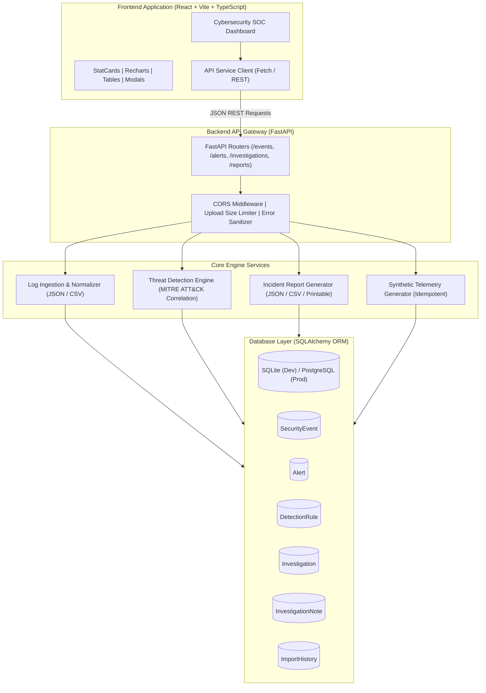

# ThreatForge — System Architecture & Design Specification

ThreatForge is a web-based security monitoring and threat detection platform engineered for SecOps practitioners, cybersecurity students, and incident responders. It ingests multi-source security logs, normalizes heterogeneous event formats into an RFC-compliant schema, executes correlation-based detection rules mapped to MITRE ATT&CK®, coordinates structured analyst investigations, and exports audit-ready incident reports.

---

## 1. High-Level Architecture Overview

---

## 2. Core Modules

### 2.1 Ingestion & Normalization Pipeline (`app/services/log_parser.py`)
Security logs generated by firewalls, identity providers, and endpoints arrive in varying structures. The log normalizer:
1. **Size & Content Validation**: Enforces `MAX_UPLOAD_SIZE_MB` limits and checks file encodings safely before disk or memory parsing.
2. **Flexible Key Mapping**: Transparently maps aliases (e.g. `src_ip`, `client_ip`, `host` $\to$ `source_ip`; `user`, `account`, `login` $\to$ `username`; `result`, `outcome` $\to$ `status`).
3. **Timestamp Normalization**: Translates varied ISO-8601, Unix epoch (seconds/milliseconds), and Syslog timestamp strings into standardized timezone-aware UTC `datetime` objects.
4. **Record Sanitation**: Rejects malformed JSON syntax or defective CSV structures with descriptive error reports, recording import statistics in `ImportHistory`.

### 2.2 Threat Detection Engine (`app/services/detection_engine.py`)
The detection engine operates as an explainable, deterministic rule evaluator:
- Evaluates sliding time windows across chronologically sorted security events.
- Employs MITRE ATT&CK technique classifications for all generated alerts.
- Enforces alert deduplication across `(rule_id, source_ip, username)` keys to avoid alert fatigue.
- Supports runtime rule toggling and parameter adjustments via REST API (`/api/rules`).

### 2.3 Incident Management & Case Tracking (`app/models/investigation.py`)
- Direct escalation from any Threat Alert into an active Investigation case.
- Chronological forensic notes thread recording analyst actions, timestamps, and findings.
- State machine lifecycle: `Open` $\to$ `In Progress` $\to$ `Closed`.
- Closing an investigation auto-resolves associated threat alerts to maintain consistency.

### 2.4 Incident Reporting Engine (`app/services/report_generator.py`)
- Synthesizes executive summaries, incident profiles, correlated alerts, forensic event logs, and remediation guidance.
- Exports structured machine-readable JSON and spreadsheet-ready CSV downloads.
- Embeds standardized compliance and educational audit disclaimers.

---

## 3. Database Schema Models

| Table Name | Primary Key | Key Attributes | Relationships |
| :--- | :--- | :--- | :--- |
| `security_events` | `id` (UUID / String) | `timestamp` (UTC), `event_type`, `source_ip`, `destination_ip`, `username`, `action`, `status`, `severity`, `description`, `raw_event_data` | Indexed by `source_ip`, `username`, `timestamp`, `event_type` |
| `alerts` | `id` (`ALT-XXXX`) | `title`, `severity`, `status`, `rule_id`, `rule_name`, `source_ip`, `username`, `event_count`, `evidence` (JSON) | Correlated to rule and target entity |
| `detection_rules` | `id` (`RULE-XXXX`) | `name`, `description`, `severity`, `logic_description`, `is_enabled`, `parameters` (JSON), `mitre_attack_id` | Master rule catalog |
| `investigations` | `id` (`INV-XXXX`) | `title`, `description`, `status`, `priority`, `assigned_to`, `findings`, `related_alert_ids`, `related_event_ids` | One-to-Many with `investigation_notes` |
| `investigation_notes` | `id` (`NOTE-XXXX`) | `investigation_id` (FK), `author`, `content`, `created_at` | Belongs to `investigations` |
| `import_history` | `id` (`IMP-XXXX`) | `filename`, `file_type`, `total_records`, `imported_records`, `failed_records`, `errors_json` | Audit record of uploads |

---

## 4. Frontend State & Component Architecture
- **Single Page Application (SPA)**: Built with React 18, Vite, and React Router v6.
- **Cybersecurity Dark UI**: Designed with Tailwind CSS utilizing a custom dark obsidian palette (`#080C14`), slate borders (`#1E293B`), and emerald/cyan accent glows (`#06B6D4`, `#10B981`).
- **Real-Time Data Visualization**: Powered by Recharts for continuous area chart event timelines and radial donut alert severity distributions.
- **Resilient Connectivity**: Polling heartbeat pings `/api/health` and reflects live status in top navigation, providing clear error boundaries if the backend is temporarily unreachable.
